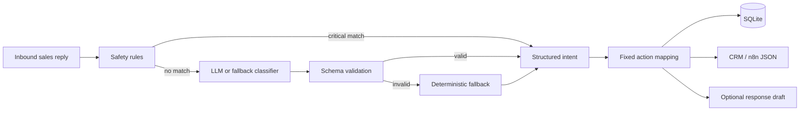
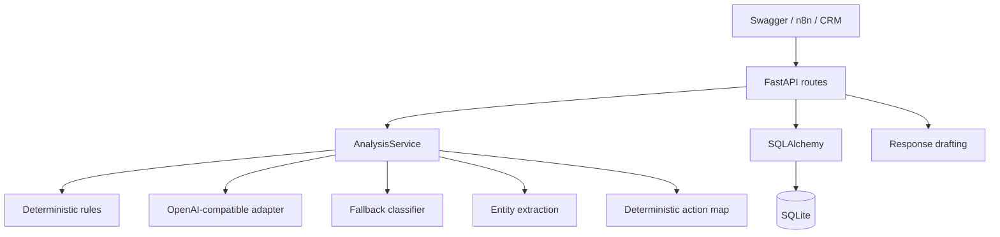

# ReplySense

**A safety-first API that turns inbound sales replies into structured intent and CRM-ready next actions.**

ReplySense demonstrates the post-outreach stage of an AI GTM workflow. It receives a prospect's
reply, identifies intent, extracts only information present in the message, selects a safe next
action, and emits predictable JSON for a CRM or n8n workflow. It is decision support: it never
sends email or schedules meetings autonomously.

## Business problem

Inbound replies are high-signal but operationally messy. Positive intent needs timely human
attention, deferrals need follow-up tasks, referrals need routing, and opt-outs or delivery failures
must be handled safely. Passing raw email text directly into an LLM makes downstream automation
fragile and risks unsafe actions when model output is wrong or malformed.

## Solution

ReplySense combines semantic classification with deterministic controls:

- An OpenAI-compatible model can interpret nuanced replies through a validated JSON contract.
- A conservative local classifier keeps the demo functional without an API key.
- Safety rules take precedence for unsubscribe, bounce, and out-of-office messages.
- A fixed action map prevents an LLM from choosing arbitrary operational actions.
- SQLAlchemy stores the original reply, analysis, and optional response draft.
- A flat webhook response is designed for Switch/IF nodes in n8n.



## Architecture



See [docs/ARCHITECTURE.md](docs/ARCHITECTURE.md) for the decision boundary and failure modes.

## Classification taxonomy

| Classification | Meaning | Recommended action | Human review |
|---|---|---|---|
| `INTERESTED` | Positive buying signal | `HUMAN_REVIEW` | Yes |
| `MEETING_REQUEST` | Requests a meeting, call, or demo | `SCHEDULE_FOLLOW_UP` | Yes |
| `QUESTION` | Asks for information | `ANSWER_QUESTION` | Yes |
| `NOT_NOW` | Defers engagement | `CREATE_FOLLOW_UP_TASK` | No |
| `NOT_INTERESTED` | Declines | `CLOSE_OPPORTUNITY` | No |
| `WRONG_PERSON` | Recipient is not the owner | `FIND_CORRECT_CONTACT` | No |
| `REFERRAL` | Redirects to another person | `ROUTE_TO_REFERRAL` | Yes |
| `OUT_OF_OFFICE` | Automatic absence response | `WAIT_UNTIL_RETURN` | No |
| `UNSUBSCRIBE` | Requests no further contact | `SUPPRESS_CONTACT` | No |
| `BOUNCE` | Delivery failure | `MARK_EMAIL_INVALID` | No |
| `UNKNOWN` | No reliable signal | `MANUAL_TRIAGE` | Yes |

## Safety model

`UNSUBSCRIBE`, `BOUNCE`, and `OUT_OF_OFFICE` patterns are evaluated outside the LLM path.
Unsubscribe has highest precedence and always becomes `SUPPRESS_CONTACT`; bounce always becomes
`MARK_EMAIL_INVALID`. Neither can produce a suggested reply. The model classifies semantic intent,
but it cannot invent an action because action selection is deterministic. Meeting and interest
signals always require human review, so ReplySense cannot schedule or communicate on its own.

## API example

Start the service and open Swagger at `http://localhost:8000/docs`.

```bash
curl -X POST http://localhost:8000/replies/analyze \
  -H 'Content-Type: application/json' \
  -d '{
    "from_email": "alex@example.com",
    "subject": "Re: Automating account research",
    "body": "Sounds useful. Can you show me how this works sometime next week?"
  }'
```

Representative analysis:

```json
{
  "classification": "MEETING_REQUEST",
  "confidence": 0.88,
  "sentiment": "positive",
  "extracted_entities": {
    "relative_times": ["next week"],
    "question": "Can you show me how this works sometime next week?",
    "meeting_intent": "Can you show me how this works sometime next week?"
  },
  "recommended_action": "SCHEDULE_FOLLOW_UP",
  "requires_human_review": true,
  "reasoning_summary": "The prospect expressed intent to arrange a meeting or demonstration."
}
```

Routes:

- `GET /health`
- `POST /replies/analyze`
- `GET /replies` and `GET /replies/{id}`
- `GET /replies/{id}/analysis`
- `POST /replies/{id}/suggest-response`
- `POST /webhooks/reply`

## n8n integration

Import [examples/replysense-n8n-workflow.json](examples/replysense-n8n-workflow.json), run ReplySense
locally, and submit sample JSON to the n8n webhook. The workflow calls ReplySense and branches on
`classification`. Configuration and production considerations are in
[docs/N8N_WORKFLOW.md](docs/N8N_WORKFLOW.md).

## Setup

Requires Python 3.11+.

```bash
python -m venv .venv
source .venv/bin/activate
pip install -e '.[dev]'
cp .env.example .env
uvicorn app.main:app --reload
```

An API key is optional. Set `REPLYSENSE_OPENAI_API_KEY` to enable semantic model analysis, along
with `REPLYSENSE_OPENAI_BASE_URL` and `REPLYSENSE_OPENAI_MODEL` for any compatible provider.

Run the quality gate:

```bash
pytest
ruff check .
ruff format --check .
mypy app --strict
```

## Docker

```bash
docker compose up --build
```

SQLite data persists in the `replysense-data` volume. Swagger is available at
`http://localhost:8000/docs`.

## Example payloads

The [examples/payloads](examples/payloads) directory includes interested, meeting-request,
not-now, unsubscribe, bounce, and wrong-person/referral cases ready for Swagger or curl.

## Limitations

- The fallback classifier is intentionally simple and less capable than an LLM on nuanced or
  multilingual replies; low-confidence `UNKNOWN` routes to manual triage.
- Regex extraction preserves ambiguous date text but does not normalize dates or understand every
  phrasing.
- Suggested replies are short templates, not autonomous messages, and require a separate request.
- SQLite and a single process are appropriate for this portfolio demo, not high-volume production.
- The API intentionally has no authentication; deploy it only in a trusted demo environment.

## Future improvements

- Add labeled evaluation data and per-class precision/recall reporting.
- Add idempotency keys and signed webhook verification.
- Add provider-specific structured-output adapters and observability for latency/token usage.
- Add CRM adapters while keeping the fixed safety and human-approval boundary.
- Add date normalization only when locale, timezone, and reference date are explicit.

## Demo and screenshots

Follow the [2–3 minute interview script](docs/DEMO.md).

> Screenshot placeholder: Swagger `POST /replies/analyze` meeting-request result.

> Screenshot placeholder: Swagger unsubscribe override showing `SUPPRESS_CONTACT`.

> Screenshot placeholder: n8n Switch node branching on `classification`.

