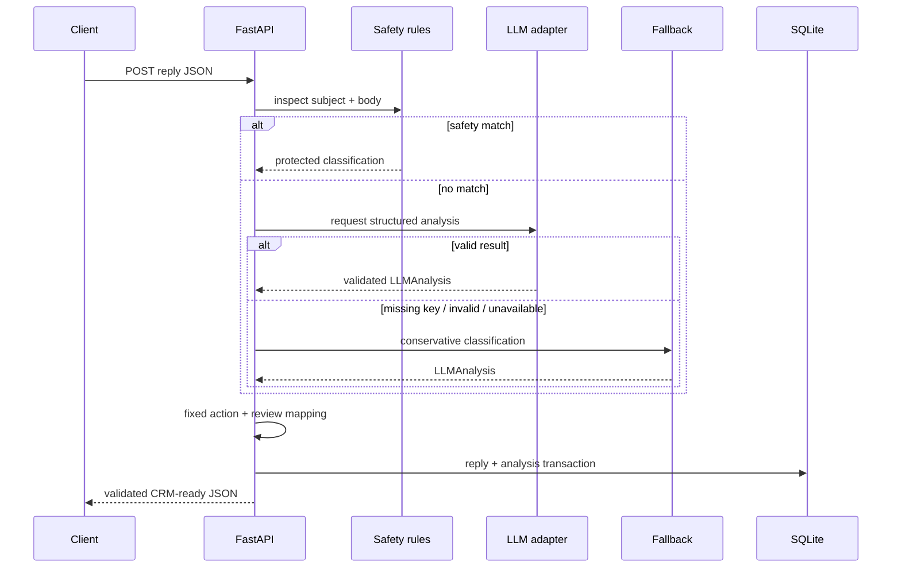

# Architecture

ReplySense is a deliberately small modular monolith. FastAPI owns HTTP validation, services own
decisions, and SQLAlchemy owns persistence. This keeps the project easy to run while preserving
clear boundaries for testing.

## Request lifecycle

1. Pydantic validates the inbound payload and rejects blank bodies or invalid email addresses.
2. `AnalysisService` runs high-priority deterministic rules over subject and body.
3. With no critical match, the OpenAI-compatible adapter requests a strict JSON object.
4. Pydantic validates the model result. Network, decoding, or validation failure returns control to
   the deterministic fallback instead of surfacing a server error.
5. A second deterministic rule pass guards the output boundary.
6. The classification enters a fixed action map. The LLM never selects an action directly.
7. The original reply and analysis commit in one transaction and become available to history and
   webhook clients.

## Safety invariants

- Explicit unsubscribe language always maps to `UNSUBSCRIBE` and `SUPPRESS_CONTACT`.
- Bounce language always maps to `BOUNCE` and `MARK_EMAIL_INVALID`.
- Out-of-office language is checked before semantic interest signals.
- `UNSUBSCRIBE` and `BOUNCE` cannot create a suggested response.
- `INTERESTED`, `MEETING_REQUEST`, and `QUESTION` require human review before communication.
- Extractors return null/empty fields rather than filling in missing facts.

## Modules

| Module | Responsibility |
|---|---|
| `app/main.py` | Routes, dependency wiring, transactions |
| `app/services/rules.py` | Critical deterministic pattern matching |
| `app/services/llm.py` | OpenAI-compatible transport and validation boundary |
| `app/services/classifier.py` | Honest no-key fallback |
| `app/services/extraction.py` | Verbatim entity extraction |
| `app/services/actions.py` | Fixed classification-to-action policy |
| `app/services/personalization.py` | Optional safe response templates |
| `app/models.py` | SQLAlchemy persistence models |
| `app/schemas.py` | API and LLM contracts |

## Failure behavior

An unavailable or malformed LLM result logs a warning and invokes the fallback classifier. Invalid
client payloads receive HTTP 422. Missing records receive HTTP 404. Draft requests for unsupported
or unsafe classifications receive HTTP 409. Database exceptions are not hidden, so operators can
detect infrastructure failures rather than receiving misleading analysis.

